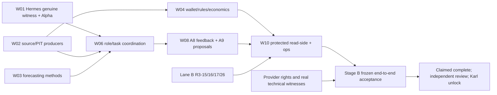

# SIDE25 — Owner decision: nine-agent + 36-capability completion

**Planning date:** 2026-11-17. **Repository:** `toobigtofailbot-maker/polymarket-strategy-lab`. **Read-only GitHub baseline:** protected `main` `1c981838c2cc3ff2fcd5991aa97cf78194a10a2f`; PR #280 merged there; sole open PR #268 (category-stratified screener), **not merged or assumed safe to modify**. The exact checked upstream Hermes tag `v2026.9.14` / v0.21.3 is `345cd2b057a452236de401d3534b8502a7465e8d`. **Authority:** PLANNING ONLY, research/engineering documentation; USD 0, no provider/model session, API product request, Alpha discovery, deployment, account, order, merge or executor dispatch. GitHub connector reads performed; no repo/host code executed or tests run.

## Decision

**GO with targeted revisions to the existing first Hermes WP; do not dispatch it yet.** Deliver nine *on-demand* specialist functions (A1–A9), **one deterministic coordinator, not a tenth agent**, and close all **36 original capabilities from 29 upstream repositories** by actual execution/consumer evidence or explicitly Karl-approved substitutions. Reuse the existing canonical market/PIT, Alpha Factory, Hermes, forecasting, WP170/WP172/WP173, Gate B/C, OMS, risk, learning and Control Center. The first indispensable gap is **real upstream Hermes child delegation with trusted child-origin/permission evidence ending in a native Alpha `ResearchEpisode`**, not another standalone research receipt. The present `research_cooperation` consumes caller-supplied roles and cannot attest actual child execution. [Native source](https://github.com/toobigtofailbot-maker/polymarket-strategy-lab/blob/1c981838c2cc3ff2fcd5991aa97cf78194a10a2f/src/data_layer/analytical_research/research_cooperation.py); [pinned upstream](https://github.com/NousResearch/hermes-agent/blob/345cd2b057a452236de401d3534b8502a7465e8d/tools/delegate_tool.py).

| Locked engineering decision | Reason | Action / first proof |
|---|---|---|
| 1. One Hermes runtime; **separate default-OFF delegated profile** | Existing `HermesInvocationPolicy` is intentionally `web` only, `delegation=False`; altering default silently broadens authority | First PROTECTED WP: exact parent/child effective-tool negative tests, original H1 policy unchanged |
| 2. **Host-trusted witness**, not agent-provided JSON | Upstream creates true child `AIAgent` sessions; current one-shot stdout + aggregate `usage-file` do **not** attest each child | Pre-edit pinned import/event feasibility; trusted host-side completion and toolset binding; refuse if impossible without an approved new pin/patch |
| 3. Reuse **native Alpha append-and-read** | `build_research_episode`, `append_alpha_factory_records`, `load_and_verify_alpha_factory_registry` already provide immutable identities and lineage | First WP must reach this consumer in an offline, advisory, cold-verifiable fixture; no new strategy/candidate claims |
| 4. All 36 remain open until a real consumer trace or approved disposition | Dated method categories **1 direct / 4 selective / 13 custom / 9 concept / 9 missing** measure *technique*, not acceptance | Single 36-row register, assigned role/owner, specific WP wave, license/provider gate and evidence standard |
| 5. Stop at independent full-system acceptance | Agent usefulness, actual provider-origin and economic edge are distinct | Frozen release, 9-role + 36-ID evidence, independent reviewer, Karl unlock **before** any Alpha discovery |

## First three **proposed** implementation WPs (not executable packages)

1. **`S10-HERMES-DELEGATED-SPECIALISTS-01`** (P0, PROTECTED; existing draft **REVISE_MINIMALLY**, uncertified): bounded true upstream `delegate_task` Forecaster+Falsifier, child effective-tool/role/usage witness, grounded citation verification, *actual* native advisory Alpha episode append+verified read. Existing sixteen-path draft is the base; do not enlarge to all nine roles. First verify that the witness seam works on exact pinned bytes *before changing code*; preserve H1 bit-for-bit; separate provider witness follows owner grant.
2. **`S10-CAP-SOURCE-PIT-01`** (P1, RUNTIME/PROTECTED if rights or runtime controls crossed): canonical approved-source/market adapters, source quality/identity/time invariants and Scout+Research consumer contract. Tests use already-held fixtures; no new real-market scan. Can pre-draft in parallel; implementation must avoid shared `research_cooperation.py` or `policy.py` while WP1 is open.
3. **`S10-CAP-FORECAST-METHOD-01`** (P1, RUNTIME): A3/A4 method interoperability, immutable forecast+abstention → native forecast evaluation/WP170 *interface* compatibility, pinned upstream method parity, no outcomes sought or expected profit estimated. May proceed parallel to WP2 on disjoint files, once first specialist and source packet contracts are frozen.

## Critical-path delivery and parallel lanes

**Only true API/schema/permission dependencies constrain parallelism.** Source/PIT, upstream forecast parity, and independent Lane B work do not have to wait for hosted Hermes inference; both must eventually converge on frozen source/role contracts. Host release alignment and an IO acceptance check are **non-economic operational side work** only when separately authorized; don't block research integration on server administration.

## Existing work to retain, avoid or remove

**KEEP:** actual pinned Oracle3 constraint/fee and Metaculus source-archive calls; official Polymarket Python SDK public search on mocked transport; original H1 web-only Hermes profile; native Alpha, qualification, paper, OMS/risk, PIT, feedback and cockpit. **CONNECT:** Hermes child origin → cooperation → Alpha; other role outputs → their native readers; source/forecast/Wallet/rules → verified downstream consumers. **BUILD ONLY THE MISSING SEAMS:** opt-in delegation guard/witness, nine-role task routing + durable attempt ledger, conditional adapters, A9 proposal interface, read-side system observability. **REPLACE/ELIMINATE:** *proposals only*, after same-fixture equivalent function + Karl decision; no early removal, custom framework or package upgrade. **NO NEW DEPENDENCY** by default; permit sandboxed exact-pin upstream tests with existing approved isolation.

## Immediate owner decisions (max three)

1. **Approve the revised exact-byte, independent-reviewable first PROTECTED WP for subsequent certification** — *not this master plan as an implementation grant*. No certificate has been issued and code cannot begin yet.
2. **Confirm the security decision tree**: prefer exact pinned v0.21.3 + host-created child witness; if the pre-edit proof shows the CLI cannot expose trustworthy child events within scope, return one concrete `PIN_WITNESS_BLOCKED` decision for a small pinned patch/isolated broker or separately reviewed upgrade. **No silent privilege expansion.**
3. **Give a future direction, not secrets**, for third-party real technical witnesses and license/provider rights (Firecrawl/provider, PMXT, Synpath, Agent Reach, Kairos, LSE, Jon Becker). Each actual session/cost/credential still requires its own bounded approval; refusal means honest `PROVIDER_BLOCKED` rather than manufactured completion.

## Acceptance, stop and anti-drift

The exact Stage B review milestone is `FULL_SYSTEM_INTEGRATION_ACCEPTANCE`. After **every** implemented WP, Side25 produces a ≤1-page `INTEGRATION_DELTA_REVIEW` with exact committed SHA/CI, real producer→consumer proof, nine-role/36-row changes and blocked owner decisions; do not self-certify independent evidence. Upon both objectives' verified implementation, **STOP** with `NINE-AGENT + 36-CAPABILITY SYSTEM — CLAIMED COMPLETE / INDEPENDENT REVIEW REQUIRED`, exact frozen SHA, evidence ZIP, nine-role and 36-ID matrices and approved exceptions. No discovery, weather DATA-03, NBA experiment, strategy qualification or real trading before a separate independent PASS and Karl's explicit unlock.

**Source precedence:** owner directive > original `NINE_AGENT_FULL_INTEGRATION_PLAN_2026-11-17.md` (indexed Library text, original bytes not materializable here) > independent research return (research recommendations, not automatically implementable) > exact native GitHub/source pins. This ZIP records what was independently cross-checked and what remains only a historical audit claim; see `09_SOURCE_TO_CLAIM_REGISTER.csv`. The user-mentioned `SIDE25_NINE_AGENT_IMPLEMENTATION_PLANNING_HANDOFF.zip` itself was not mounted; its owner directive was supplied independently and its referenced research archive and existing first-WP ZIP were inspected. No missing handoff contents are represented as verified.
