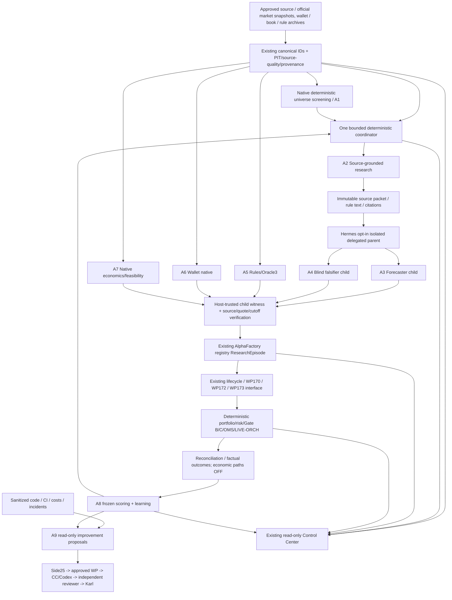

# 01 — Current-to-target architecture and concrete boundary decisions

**Evidence level:** Repo `main` at `1c981838c2cc3ff2fcd5991aa97cf78194a10a2f` re-checked 2026-11-17 through GitHub. Pinned Hermes `345cd2b057a452236de401d3534b8502a7465e8d` inspected. These are **static code/API confirmations, not execution results**. Prior audit and independent research contain dated assertions; those are not new test outcomes. Direct GitHub source URLs use these immutable SHAs throughout this plan.

## Target: deterministic canonical owner + one Hermes specialist runtime

**The coordinator is not an additional model agent.** Conditioned agents A1/A2/A5/A6/A7/A8/A9 can be *native tool-backed functions* with optional deep reasoning when justified; A3/A4 are the first genuinely independently delegated Hermes roles. No nine daemons, nine canonical stores, uncontrolled recursive tool dispatch or default nine-fold model charge.

## Boundary inventory — before / after and necessary action

| Boundary / current callable | Current fact and missing crossing | To-be caller → callee; authoritative ID/time/consumer; engineering acceptance | Action |
|---|---|---|---|
| `src/data_layer/polymarket/{public_client,market_catalog,market_truth_store}.py`; `src/data_layer/analytical_research/official_sdk_search_bridge.py` | Official SDK public search via mocked transport exists; selected cross-venue sources unconnected | Approved source → native canonical market/asset ID + captured/as-of clock → PIT/Alpha A1; check duplicates/selection denominator | KEEP + CONNECT conditional providers (C2) |
| `point_in_time_market_research/research_provenance.py`; `source_grounding.py::{load_corpus,bind_rule_texts,evaluate_sources}` | Strong offline source cutoff and quote checks; allowed source not proof of truth | Original raw hash, source ID, rule version, cutoff → A2 evidence → A3/A4 blind packet; fail for late/unavailable/tampered bytes | KEEP + CONNECT (C1/C2) |
| `src/research_runtime/hermes_controlled_runtime/{policy,controller,runner}.py` | Web-only immutable policy, one-shot final stdout; `delegation=False`; no trusted per-child stream | Dedicated opt-in policy (parent exactly web+delegate; leaf exactly web), genuine pinned upstream AIAgent children → *host-owned* child receipt/usage/permissions; old H1 request unchanged | Narrow BUILD (C1) |
| `research_cooperation.py::{assess_question,build_core,verify_receipt}`; `run_hermes_cooperation.py` | Historical case includes caller-authored A3/A4; receipt says origin unverified | Frozen role-specific child output+host witness → unchanged native quote/source evaluator → registered advisory episode, with refusal atomicity | CONNECT, never relabel old receipt (C1) |
| `alpha_factory.py::{build_research_episode,build_opportunity_candidate}`; `alpha_factory_registry.py::{append_alpha_factory_records,load_and_verify_alpha_factory_registry}` | Canonical append-only, validated ancestry; no trusted child ingestion | Existing verified source/candidate/family lineage → `ResearchEpisode` producer receipt and reader that actually loads it; no fabricated candidate/strategy | KEEP + CONNECT (C1/C5) |
| `forecast_evaluation.py::{forecast_case,score_cohort,map_wp170_membership}`; `experiment_os.py` | Numeric calibration / frozen WP170 cohort binding; not pinned upstream model invocation | A3 immutable forecast/confidence/abstain + exact horizon, source cutoff, split ID → existing forecast receipt; no real outcome/test until unlock | CONNECT + selective upstream parity (C3) |
| `related_market.py`, `related_market_economics.py`, `oracle3_upstream_bridge.py::{load_upstream,assess_rel_core}` | Real pinned Oracle3 calls on synthetic cases, rule equivalence not economically witnessed | A5 rule-leg graph with canonical condition/settlement and fee versions → native conservative feasibility; absent witness refuses | KEEP + CONNECT (C4) |
| Existing `wallet_signal_...` data layer, `src/data_layer/analytical_research/pmxt_v2.py` | Local wallet/trade/PMXT history code; provider rights/identity matching missing | A6 public wallet provenance + delay/selection/leakage flags → canonical Alpha/learning read consumer; no account tokens | CONNECT, provider-gated (C2/C4) |
| `execution_feasibility/evaluator.py::assess_execution_feasibility`; `research_runtime/executable_edge/evaluator.py`; `paper_trading/engine.py::{create,create_research}` | Native cost and research-paper mechanics exist; research-only mode is not qualified trade | A7 read-only market/version/book/fee packet → true native feasibility refusal/snapshot; WP172/WP173 schemas independently checkable without new edge claims | KEEP + CONNECT (C4/C7) |
| `qualification_gate.py::evaluate_qualification_gate`, `strategy_lifecycle`, `execution_gateway/{gate_b,gate_c,live_orch}.py` | Protected gates dormant; no strategy admitted; real account/host approval missing | Valid *fixture* research lineage → qualification schema refusals → existing protected read side; model must never call order/permit directly | KEEP, non-economic acceptance (C7) |
| `learning_feedback.py::{score_frozen,build_proposals}`, `hermes_controlled_runtime/autonomous_feedback.py` | Frozen scoring/advisory proposals exist; future-routing consumption not proven | A8 canonical outcome+immutable original forecast → versioned non-economic routing suggestion → *approved* coordinator; unknown outcome/cost remains unknown | CONNECT (C6) |
| `operator_cockpit_research.py::{load_alpha_factory,load_hermes}`, frontend API, `live_orch.py` | Read projections exist; lacks integrated nine-role attempt/cost/failure and provider status consumer | Canonical task/store read-only status projections → Control Center; fixed-test evidence of alert, stale/offline and no authority escalation | CONNECT (C7) |
| Repository/CI/incident reports | No independent A9 improvement proposal consumer | Sanitized CI/test/cost/incident proof → `BotImprovementProposal` → Side25 review queue/WP drafting; **no write API** | Small BUILD (C6) |

## Why existing architecture wins

- `alpha_factory_registry` and native provenance already enforce lineage and cold verification; a new event store or research memory DB would duplicate them. Use existing append-only semantics and add only a bounded task journal if there is no genuine existing lease/idempotency mechanism; avoid a second Alpha registry.
- Hermes is the ONLY agent execution framework. Do not add CrewAI/LangGraph/AutoGen/PydanticAI, generic MCP orchestration, unrestricted cron or provider fallbacks absent a measured missing capability.
- Native fee/risk/OMS remains sole economic arbiter. A7 is an analyst of read-only deterministic results, not a replacement PnL engine. A9 produces suggestions, not patches, PRs or merges autonomously.
- Current `src/data_layer/analytical_research/oracle3/{arbitrage,fees}.py`, `metaculus_source_archive/{quality,canonicalize}.py` and related bridges **already call** selected pinned upstream leaves offline; retain their provenance/license. No duplicated upstream import just to increase adoption count.
- `pmxt_v2.py` is a **local archive format**; it is not proof that PMXT SDK/router or Synpath provider integration exists. No external provider entitled until consent.

## Hermes feasibility/security alternatives — an explicit decision gate

| Option | Pinned compatibility | Actual trusted child witness | Permission and maintenance | Disposition |
|---|---|---|---|---|
| **A. Pinned Hermes v0.21.3, exact `delegate_task` + smallest host-owned child evidence seam** | Upstream `_build_child_agent`, `_run_single_child`, child toolset resolver exist; one-shot declares stateless channel | **NOT YET PROVED** from stock one-shot; must bind internal spawn/completion with effective tool inventory and returned output hashes | Minimal conceptual fit, PROTECTED; prove pre-edit with sandboxed actual upstream runtime and fake model | **PREFERRED CONDITIONALLY** |
| **B. Two distinct web-only CLI one-shots** | Existing H1 API works | Two parent invocations could have origin receipts, **not genuine upstream delegation** | Safest temporary engineering fallback only | **NOT acceptable closure** for R3-05 without Karl disposition |
| **C. Tiny pinned upstream patch/host-side instrumentation** | Patch pin digest and license inventory change | Could emit owned immutable event via private pipe/FD | New security and exact-byte PROTECTED certification; independent compatibility | Conditional escalation after A blocked; no silent patch |
| **D. Different Hermes version or second agent framework** | Not proven; may change API, defaults, tools, pricing | Needs fresh tests/security/license review | Highest migration blast radius | Do not recommend on present evidence |

### Pinned API and permission specifics verified at source

`NousResearch/hermes-agent@345cd2b0`: `tools/delegate_tool.py::delegate_task` constructs actual separate `AIAgent` children; `_build_children` inherits parent tools, `_resolve_child_toolsets` intersects against parent and composite-expands. `delegate_tool_config.py` defaults to nonzero concurrency, `max_spawn_depth=1`, `orchestrator_enabled=true`, `inherit_mcp_toolsets=true`; thus parent+children must be effectively checked **after** registry resolution, not just by CLI `--toolsets` strings. `hermes_cli/oneshot.py` sets `HERMES_YOLO_MODE=1`, `HERMES_ACCEPT_HOOKS=1`, and returns plain stdout + aggregate `--usage-file`; it provides no externally trustworthy child-level attestation automatically. `run_agent.AIAgent._dispatch_delegate_task` dispatches actual upstream function. Source citations: [delegate](https://github.com/NousResearch/hermes-agent/blob/345cd2b057a452236de401d3534b8502a7465e8d/tools/delegate_tool.py), [toolsets](https://github.com/NousResearch/hermes-agent/blob/345cd2b057a452236de401d3534b8502a7465e8d/tools/delegate_tool_toolsets.py), [config](https://github.com/NousResearch/hermes-agent/blob/345cd2b057a452236de401d3534b8502a7465e8d/tools/delegate_tool_config.py), [one-shot](https://github.com/NousResearch/hermes-agent/blob/345cd2b057a452236de401d3534b8502a7465e8d/hermes_cli/oneshot.py), [native policy](https://github.com/toobigtofailbot-maker/polymarket-strategy-lab/blob/1c981838c2cc3ff2fcd5991aa97cf78194a10a2f/src/research_runtime/hermes_controlled_runtime/policy.py).

**No direct source-code removal approved:** only enumerate old paths and independently prove a replacement's consumer evidence and migration. Where upstream equivalent is unsafe, a suggested ELIMINATE/REPLACE is only an `OWNER_DISPOSITION_REQUIRED` proposal. User's current mandated 36 may not be reduced by this master plan.
