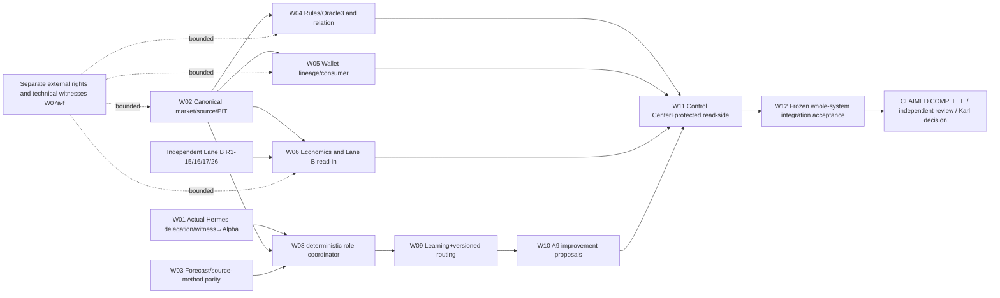

# 04 — Stage A/B dependency-ordered implementation roadmap

**These are proposed WP boundaries, not execution authorization.** Only `S10-HERMES-DELEGATED-SPECIALISTS-01` has an actual existing prompt/spec draft. All other IDs are *provisional*, scopes and size classes determined by fresh predraft on the actual merge head. Current main: `1c981838c2cc3ff2fcd5991aa97cf78194a10a2f`; PR #268 remains open and **must not be silently merged, superseded or edited**. Owner-approved capability-first order controls: Stage A software completion → Stage B whole-system integration → STOP independent acceptance → later owner-unlocked Alpha discovery → later qualification → later supervised/full live.

## 1. Dependency graph, safe parallelism and true critical path

**Primary critical path:** W01 genuine child host-witness proof → W08 coordinator → W09/W10 verifiable return loops → W11 read-side/recovery → W12 independent acceptance. **Concurrent**: W02 source identity, W03 forecast-method parity, W04 rules, W05 wallet, W06 economics (when their *own* source contract is stable), independent Lane B, and only permissioned W07 source integrations. No provider rights assumed. Each WP returns to Side25 for `INTEGRATION_DELTA_REVIEW`; no plan drift or WPs for already-proven functionality.

### Common execution rules for all subsequent approved WPs

- **ADOPT LOOP:** Karl approves exact execution scope → Side25 final frozen prompt/spec & owner-governance posture → CC/Codex autonomous implementation/debugging → one PR plus single CC evidence ZIP → Side25 technical review + `INTEGRATION_DELTA_REVIEW` → independent reviewer where required → Karl-only merge. **Mandatory startup**, native repo readiness/guards, fresh actual installed-skills discovery, **Ponytail LITE first actual skill invocation after startup**, predraft, smallest applicable functional tests, one-shot review, verification-before-completion and relevant Hermes/upstream/security/domain specialists. If a skill is absent report `UNAVAILABLE`; do not claim invoked.
- Governance: `RUNTIME` for approved research-runtime/offline integration with no credential/execution/live authority; **PROTECTED** for delegated permission widening, credentials, execution/OMS/risk, sensitive canonical controls or chosen stricter protection; independent exact raw-byte **12-lens certificate** before protected source edits. Existing `docs/ai/codex/{WP_DRAFTING_STANDARD,WP_SPEC_STANDARD,PROTECTED_PATHS}.md` is canonical. No self-issued certificate, no general provider authorization by a test WP.
- Tests: proven real native producer→consumer trace, hard negative/permission checks, restart/idempotency when mutable, exact-head local complete applicable suite and CI at final pushed head, no placeholder PASS counts, original frozen evidence cold-replay. One-shot correction of ordinary in-scope bugs stays in same PR; material out-of-scope permission/API defect triggers clear escalation and bounded follow-on decision rather than silent scope growth.
- **No new Alpha discovery, weather/NBA accrual, market GET, profitability testing, paid model session, host action, credential read, paper order or live economic behavior.** Only frozen fixture, local dry run and actual pinned upstream code loaded through isolated fake provider when authorized by specific WP. Normal Git/CI workflow traffic is distinct from product API network activity.

## 2. Minimum-complete WPs / bounded capability groups

| Priority / proposed ID | Bundle and role/36 coverage | Proven current code to retain → missing real connection | Dependency / parallel and risk | One-shot engineering output; no-goals |
|---|---|---|---|---|
| **P0 W01** `S10-HERMES-DELEGATED-SPECIALISTS-01` | C1: A3/A4 foundation; R3-05, R3-05-CITATIONS | `policy/controller/runner`, `research_cooperation`, SRC-01 and Alpha registry. Actual upstream child→host-trusted witness→grounded native cooperation→verified Alpha episode missing | No predecessor beyond confirmed main/#280; **PROTECTED** Risk4; first. Pinned feasibility proof before source edits | Real exact-pin `delegate_task` used offline, two distinct child sessions and effective tools, no pre-blind leak, signed/owned output, native consumer append+read; NO real provider / new strategy / all-nine roles |
| **P1 W02** `S10-CAP-SOURCE-PIT-01` | C2: A1/A2; R3-02, R3-07, R3-12-SAMPLER, R3-23/24/25/27/28, R3-01-SOURCE_ARCHIVE, R3-07-ROUTER | Existing `market_catalog`, `official_sdk_search_bridge`, `pmxt_v2` (local only), `source_grounding`, Metaculus bridge. Missing cross-source canonical output+real A1/A2 consumer and provider-missing refusal | Source schema/provenance fixed; **parallel predraft with W01**, no shared policy/coop paths; **RUNTIME** offline, PROTECTED if new runtime/network entitlements | Explicit target source/PIT manifest → A1 census/Alpha reader + A2 citation consumer and known refusal; do **not** activate PMXT/real-time market scan or alter PR268 screener |
| **P1 W03** `S10-CAP-FORECAST-METHODS-01` | C3: A3/A4/A8 method parity; R3-01, R3-06, R3-10/10-WANG, R3-12/12-SAMPLER, R3-18/20/22 | `forecast_evaluation`, `experiment_os`, WP170 mapping. Missing upstream ForecastBot/Wang/Gnosis/ForecastBench source parity and bound forecast→native receipt without outcome leakage | Offline frozen sample and new role receipt schema when ready; can run independently W02 for method comparisons, **RUNTIME**; avoid `policy.py` while W01 | Explicit pinned source method called OR documented parity and owner decision, forecast/abstain → existing native forecast/WP170 read with honest evidence. NO new OOS, forecasting edge or actual outcome accrual |
| **P1 W04** `S10-CAP-RULES-RELATIONS-01` | C4-A: A5/A4/A7; R3-03/03-FEES, R3-04, R3-11, R3-19 | Pinned Oracle3 `load_upstream/assess_rel_core` exists; Chainstack/Synpath relation, Kairos settlement actual integration absent | W02 rule/source identity; Kairos rights **independent W07 owner gate**. **RUNTIME**, PROTECTED if economic source/permissions changed | Two-leg/multi-leg canonical payoff/settlement checks → native `related_market_economics` and feasibility read. NO trade, no inferred rule equivalence from text |
| **P1 W05** `S10-CAP-WALLET-PUBLIC-01` | C4-B: A6/A2/A4; R3-14, public wallet consumers | Existing wallet public profiles/copyability/report/Alpha; full Jon-Becker source and exact PIT wallet-to-source admission missing | W02 IDs; owner-rights gate on Jon Becker. **RUNTIME** or PROTECTED if personal/credential boundary; disjoint from W04 | Frozen wallet identity/lag/noise cohort → native report/Alpha advisory consumer; no wallet-copy profitability or account read |
| **P1 W06** `S10-CAP-EXEC-ECONOMICS-01` | C4-C: A7; R3-09/09-BOOK_GAPS, R3-15/16/17/26 **Lane B**, R3-03-FEES | `assess_execution_feasibility`, `executable_edge`, `nautilus_offline`, WP173 paper. Missing certified approved Lane B read + book-gap/protocol/fee consumer links | W02 market versions, **Lane B artifacts separately owned**; Synpath rights W07. **RUNTIME** for read-only; PROTECTED if execution/OMS path touched | Frozen partial-book/gap/fee → native feasibility/refusal + paper-model read; never build second trading engine or touch live canary |
| **Conditional W07a–f** named provider integrations (not one giant WP) | C2/C4 external: PMXT, Agent-Reach, Synpath, LSE, Kairos, Jon-Becker, optional MCP/book and source rights | No true approved network/provider witness; existing native adapters only partially suitable | **OWNER rights, license, exact protocol, cost/session caps first**; each independent bounded RUNTIME/PROTECTED task if needed | One granted provider source→PIT→native consumer and source truth/refusal; no authorization = **PROVIDER_BLOCKED**. Never merge incompatible providers into one credential WP |
| **P1 W08** `S10-CAP-NINE-ROLE-COORD-01` | C5: all A1–A9 routing; R3-29, R3-21 only if useful | `autonomous_opportunity_cycle.evaluate_once` is injected choice preview; `context_broker`, Hermes strategy manager and Alpha queues exist. Missing true conditional dispatch, role/task provenance and durable attempts | W01 witness schema and stable W02 source contract; **PROTECTED** if scheduler/daemon or protected policy; prefer finite offline no-background initial mode | One native deterministic coordinator, unique task/case/role IDs, skip/failure denominator, finite auto-recovery, consumer receipts; no general agent framework or future Alpha scanning |
| **P1 W09** `S10-CAP-LEARNING-ROUTING-01` | C6-A: A8/A3; R3-06/20/22 | Native `learning_feedback::{score_frozen,build_proposals}` + `autonomous_feedback` exists. Missing versioned owner-controlled next-task routing consumer | W08 task/version metadata and existing frozen fixtures; **RUNTIME** (no real outcomes) | Sealed prior forecast+synthetic **test-only** later outcome → native score → non-economic versioned routing suggestion consumer; no auto-promotion or real fresh label collection |
| **P1 W10** `S10-CAP-BOT-IMPROVEMENT-01` | C6-B: A9; R3-29, R3-21 as approved | Side25 reviewer and CI/status evidence exists; no A9 typed improvement proposal/Side25 intake | Can build data contract independently of W09; then connect; **RUNTIME** unless touching workflow governance/agent tools | Actual sanitized CI/cost incident → reproducible `BotImprovementProposal` → human-controlled ADOPT LOOP read/triage; NO auto code changes, commits, policies or tool install |
| **P1 W11** `S10-CAP-OPERATIONS-READSIDE-01` | C7: all roles, A7/A8/A9, crosscutting 36 | `operator_cockpit_research`, `live_orch`/risk/OMS/host tooling present. Missing nine-role metrics, source/permit truth, restart/unknown-result visibility and integrated non-economic protected read-side | W08–W10 receipts + W04–W06 read projections; **PROTECTED** if touching gate/risk/OMS, otherwise bounded RUNTIME read path; host/network separate owner action | Frozen fixture to existing cockpit + fault/restart/permit refusal; original execution/risk logic unchanged unless proven defect; no production deployment/real API |
| **P0 W12** `S10-CAP-FULL-INTEGRATION-ACCEPT-01` | C8: all A1–A9 and 36 IDs | Existing tests, PR evidence, status/capability register; need one exact frozen 9/36 role/consumer/recovery proof | After all real required WPs, provider witnesses or owner disposition and CI; no new governance engine; independent reviewer not executor | One immutable frozen release evidence ZIP and `CLAIMED_COMPLETE_PENDING_INDEPENDENT_REVIEW` or candid `INTEGRATION_INCOMPLETE`; **hard stop, no Alpha unlock** |

**How to treat row-level adoption:** The 36-ID CSV maps *every* original ID to one or more of these bundles. W07 is a grouping label for **separate, consented provider tickets**, not a promise to implement all unrelated external source drivers in one oversized WP. For candidate redundant sources (TS SDK, CCXT, pykalshi, MCP and Valory), first prove actual same-fixture native parity/utility; any ELIMINATE/REPLACE is a formal recommendation **requiring Karl's explicit decision**, not an automatic closure. In-house code does not count as true upstream reuse if source method was promised.

## 3. The first three WPs — implementation-ready predraft decisions

### W01 — existing `S10-HERMES-DELEGATED-SPECIALISTS-01` (the first priority)

- **Gap:** existing `tools/alpha/run_hermes_cooperation.py` receives caller-authored pairs and records `ABSENT_NO_HERMES_INVOCATION`, while pinned Hermes `delegate_task` creates actual child agents. Native `HermesInvocationPolicy` forbids delegation. Stock `-z` stdout+usage-file does not attest child sessions/tools/outputs. **No trusted native Alpha consumer** of genuine child pair exists.
- **Scope basis:** the existing **16-path PROTECTED/L draft**, including `policy.py`, `runner.py`, proposed `delegated_specialists.py`, proposed `tools/alpha/run_hermes_delegated_specialists.py`, targeted tests, docs and **independently reviewer-issued** certificate; preserve existing `controller.py`, H1 policy identity/default, historical cooperation API/receipts and prior tests. Do not invent exact extra paths or extend to A1–A9.
- **Required pre-edit feasibility:** with exact pinned `hermes-agent@345cd2b0` installed in authorized isolated local test environment, verify real internal `delegate_task` `_build_children/_run_single_child` path, tool-registry pruning (including composite+MCP), host-owned child receipt/completion path, and whether it can be embedded in the already declared 16 paths without modifying upstream; build no fake event source. If impossible, **STOP with pin/evidence blocker**, choose audited small upstream patch/broker or version comparison through a separately authorized PROTECTED scope; *do not let CC unilaterally rewrite the runtime or overrun scope*.
- **Actual output:** network-blocked fake model makes actual upstream parent+two children; host-origin nonce/session/result+tool proof; cold-verifies admitted SRC-01; calls unchanged `research_cooperation.assess_question`; builds `alpha_factory.build_research_episode` from existing seeded candidate/family with `DATA_INSUFFICIENT`, `OTHER_VALIDATED_ADVISORY`, `advisory_only/no_*_authority=True`; append through `alpha_factory_registry.append_alpha_factory_records`, cold load and verify new head/ID; no provider or actual strategy.
- **Tests:** effective parent tools exactly {web_search, web_extract, delegate_task} and children subset {web_search, web_extract}; duplicate/swapped child/session, orchestrator/nested delegation, MCP inheritance, composite alias, file/terminal/cron/browser/code injection, invalid source/quote/cutoff, incomplete event or costs, no append on failure, idempotent replay and unchanged legacy H1 golden bytes. Verify actual exact pinned function invoked (not mocked away). Cold source + Alpha consumer link essential. **Governance:** full independent 12-lens PROTECTED certificate against exact raw prompt/spec before implementation authority; Ponytail LITE first skill when installed.
- **Non-goals:** actual paid inference, any provider access, *all nine roles*, changing old `research_cooperation` benchmark, source registry outside one offline fixture, venue/strategy qualification, scheduler, economic operations.
- **Effort:** **medium–high, uncertain**, dominated by whether trusted host-origin evidence is possible at the exact pin. One bounded predraft proof, not recurring speculative WPs. At WP close, Side25 audit credits A3/A4 + R3-05/CITATIONS only as **ENGINEERED_OFFLINE** until actual provider proof.

### W02 — bounded market/source/PIT connection, disjoint

- **Input:** existing frozen official SDK/search, native `market_catalog`, SRC-01 archive, Metaculus quality and local PMXT fixture. **Output:** source/market/rule identity envelope consumed by real A1 triage and A2 native quote/index consumer, with seen-at vs known-at and accepted/refused denominators. **Reason:** A3/A4 and all future agents must speak one canonical source language. No new market discovery or PMXT client requests.
- **Evidence:** actual official SDK mocked HTTP call and existing `source_grounding` content verification; measured same-fixture retrieval quality with negative false matches; 36-row status R3-23 and R3-01-SOURCE_ARCHIVE remains offline accepted leaf, R3-07/ROUTER provider-blocked. **Governance:** RUNTIME offline; requires no shared Hermes policy/Alpha registry write modification; PR #268 remains separate owner and merge collision check. **Effort:** medium. **Parallel:** start after source contract is published; may pre-draft while W01 proceeds.

### W03 — forecast source/method parity, disjoint

- **Input:** frozen forecast cohorts and original upstream Metaculus, prediction-market-pricing and ForecastBench methods. **Output:** exact original sampled/training cohorts and method-version/advisory forecast receipt consumed by existing `forecast_evaluation` and WP170 **schema only**; after W01, attach actual A3 child-origin association. **Tests:** model/provider stub, train/test leakage, abstention, exact same-case native-vs-upstream scores, no outcome used before issuance. **Governance:** RUNTIME offline, no model/provider permission. **Effort:** medium; may run parallel to W02 if `alpha_factory.py`/`policy.py` unchanged.

## 4. Practical parallel execution and collisions

| Independent lane | Work allowed without delaying W01 | Shared collision to avoid | Real merge/evidence dependency |
|---|---|---|---|
| Hermes secure core | W01 only, one PROTECTED PR | `policy.py`, `runner.py`, `docs/wp_specs/...`, later W08 route | W08 cannot bind imagined child evidence until W01 exact head accepted |
| Source/intelligence | W02 local frozen source adapters, W07 provider contract research (no external calls without grant) | `source_grounding`, `alpha_discovery`, external-producer optional dependency | Rebase onto last Karl-merged main; #268 screener open until Karl decides |
| Forecast/metrics | W03 method parity; W09 learning prototype on frozen fixtures | `forecast_evaluation`, `learning_feedback`, WP170/C3 | Serialize changes touching identical test/episode schema; no prospective data |
| Rules+wallet | W04 and W05 on separate file families | Shared PIT ID contract / source snapshots | Freeze small interface first; group new adapters by domain only |
| Lane B | R3-15, R3-16, R3-17, R3-26 independently owned | `nautilus_offline`, paper/OMS/fee models | W06 consumes only merged, reviewed signed/read-only output; no Lane B takeover |
| Operations/Control Center | Offline read projection and release candidate compatibility | `live_orch.py`, `execution_gateway`, frontend | PROTECTED if those paths change, no operational SSH/deployment implied |

**Relative engineering estimate only, not a delivery promise:** W01 3–8 focused engineer-days *if the pin is directly attestable*, otherwise a separate owner/pin decision; W02/W03/W04/W05/W06 each 2–7 engineer-days; W08 4–10; W09/W10 each 2–6; W11 3–8; W12 2–5 technical/reviewer days. Provider rights/license procurement and real technical witnesses are **unbounded external delays** and can dominate all code effort. These ranges are planning assumptions, not verified historical velocity or financial commitments. Consolidate tightly related substeps; avoid a WP per adapter or oversized multi-authority XL.

## 5. Wave checkpoints and evidence

- **C1 complete:** genuine exact-pin two-child call and trusted tool/identity, native cooperation+Alpha consumer; legacy H1 byte-parity; new producer still offline/zero provider. No separate model proof by default.
- **C2/C3 complete:** each declared approved producer emits canonical PIT/source/method receipt and native consumer actually reads it; remaining providers explicitly `PROVIDER_BLOCKED` with owner decision rather than cosmetic closure.
- **C4 complete:** A5 rules, A6 wallet, A7 economics through actual native consumer, including Lane B read contract; no order/signer access; synthetic negative settlement/book/wallet tests.
- **C5/C6 complete:** conditional role routing with honest skipped-role denominator, A8 versioned future research suggestion consumed, A9 improvement proposal enters Side25 process without modifying code, budgets/unknown result tracked.
- **C7 complete:** fault/restart/kill/read-only Control Center and protected technical feasibility/gateway interface shown without economic invocation; host alignment/IO warnings disclosed, not implicitly cleared.
- **C8 Stage B:** one frozen head/manifest, 9-role and 36-row proof, all required real technical provider witnesses or Karl-approved substitutions, exact-head CI and negative battery, independent reviewer. STOP at claim, never unlock discovery automatically.

## 6. Later blocked phases (not scheduled WPs)

1. **After independently accepted Stage B + Karl's express Alpha unlock:** full-market prospective opportunity discovery with all approved agents/capabilities, real freshness/coverage/source-right caps, no automatic trade.
2. **After discovery authorization:** actual method-specific qualification/OOS (WP170 prospective data, WP172 feasibility, WP173 paper if mandatory), genuine outcomes, after-cost edge and selection-denominator evidence; weather DATA-03/NBA historical experiments only on later separate decision.
3. **After separate legal/venue/account/host/capital/risk authorizations:** owner-attended first real order through exact existing Gate B/C/LIVE-ORCH/OMS and reconciliation, then separately permitted supervised pilot with kill-switch/rollback.
4. **After repeatable positive evidence and new explicit limits:** bounded full autonomous research/admission/live portfolio with monitoring and operator override. No assumption that fully built capabilities guarantee profitable trades.
